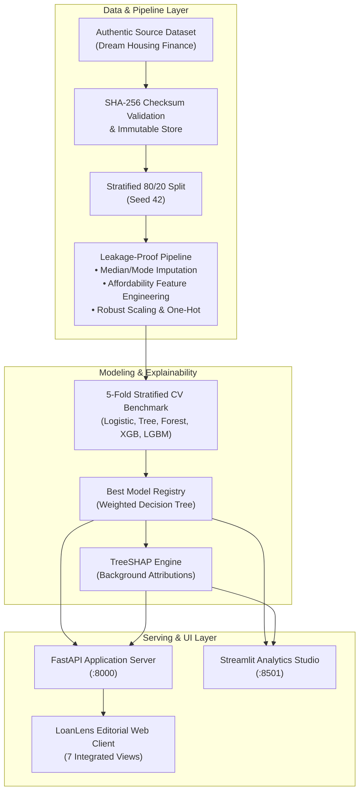

<div align="center">

# LoanLens
### *Production-Grade Explainable Housing Loan Screening Platform*

[](https://www.python.org/)
[](https://fastapi.tiangolo.com/)
[](https://streamlit.io/)
[](https://scikit-learn.org/)
[](https://github.com/slundberg/shap)
[](https://www.docker.com/)
[](LICENSE)

<p align="center">
  <a href="#key-features">Key Features</a> |
  <a href="#architecture">Architecture</a> |
  <a href="#quick-start">Quick Start</a> |
  <a href="#model-benchmarks-and-evaluation">Benchmarks</a> |
  <a href="#api-reference">API Reference</a> |
  <a href="#explainability-and-responsible-ai">Explainability</a> |
  <a href="#docker-deployment">Docker</a> |
  <a href="#repository-structure">Structure</a>
</p>

</div>

---

## Executive Overview

**LoanLens** is an end-to-end, reproducible machine learning screening platform designed to assist underwriters and financial analysts in evaluating housing loan applications. Built with strict data-leakage boundaries, multi-model cross-validation, mathematical TreeSHAP attributions, and dual human interfaces (a bespoke, editorial-grade **FastAPI + Vanilla Web** client and a rapid **Streamlit** diagnostic dashboard).

> [!IMPORTANT]
> **Operational Scope and Intended Use**: LoanLens is a **decision-support screening assistant** trained on historical approval determinations. It does *not* forecast default probabilities, credit risk migration, or recovery values. All outputs serve to assist human underwriters, not replace statutory credit decisions.

---

## Key Features

- **Leakage-Safe Feature Engineering**: Stratified 80/20 train-holdout split before any pipeline fitting. Imputation, scaling, and debt-to-income/affordability ratios are computed strictly fold-local.
- **Multi-Algorithm Benchmark**: Rigorous 5-fold cross-validation benchmarking Logistic Regression, Decision Trees, Random Forests, XGBoost, and LightGBM with automated hyperparameter tuning and class balancing.
- **Exact Mathematical Explainability**: High-precision TreeSHAP feature attributions with additivity verification (reconstruction error $< 1.12 \times 10^{-16}$) generating waterfall plots and plain-English risk drivers.
- **Dual-Surface Production Interface**:
  - **Native Web Client**: Sub-10ms latency FastAPI backend serving a responsive, editorial-grade multi-page application with zero external runtime dependencies.
  - **Streamlit Analytics Studio**: Interactive screening sandbox featuring live parameter tuning, threshold exploration, and viva presentation documentation.
- **Bounded Batch Screening**: High-throughput CSV validation with strict MIME type checking, size caps (5MB / 1,000 records), and formula-injection (`=`, `@`, `+`, `-`) sanitization.
- **Hardened Containerization**: Multi-stage, non-root Linux Docker packaging verified across cross-platform environments.

---

## Architecture



---

## Quick Start

### 1. Clone the Repository

```bash
git clone https://github.com/ZincChloride-cyber/LoanLens.git
cd LoanLens
```

### 2. Environment Setup

The platform is optimized for **Python 3.12**.

#### Option A: Using `uv` (Recommended: Fast Setup)
```bash
uv venv --python 3.12 .venv
# On Windows:
.venv\Scripts\activate
# On Linux/macOS:
source .venv/bin/activate

uv pip install -r requirements-lock.txt
```

#### Option B: Using Standard Python `venv`
```bash
python -m venv .venv
# On Windows:
.venv\Scripts\activate
# On Linux/macOS:
source .venv/bin/activate

pip install -r requirements-lock.txt
```

---

## Running the Applications

### Launch the Primary LoanLens Web Platform

```bash
python -m web
```
Navigate to **`http://127.0.0.1:8000`** in your browser.

| Route | Purpose | Highlights |
| :--- | :--- | :--- |
| `/` | **Public Homepage** | Hero narrative, workflow timeline, interactive real-model preview, and FAQs |
| `/workspace` | **Workspace Overview** | Operational dataset summary, holdout performance metrics, model comparison |
| `/assessment` | **Single Screening** | Interactive applicant intake, dynamic decision suggestion, and local SHAP waterfall |
| `/batch` | **Batch Processing** | High-throughput CSV upload, progress tracking, and CSV injection-safe export |
| `/evidence` | **Model Evidence** | Demographic disparity audits, cost curve trade-offs, confusion matrices |
| `/methodology` | **Methodology** | Mathematical formulation, validation protocols, and regulatory limitations |
| `/references` | **Design Systems** | Reference provenance (Better, Blend, Habito) and audit trails |

### Launch the Streamlit Research Studio

```bash
streamlit run app/app.py --server.headless true --server.address 127.0.0.1
```
Available at **`http://127.0.0.1:8501`**.

---

## End-to-End Experiment Reproduction

The entire ML lifecycle, from immutable raw data ingestion to final model packaging and verification reports, can be executed via the unified pipeline orchestrator:

```bash
# Execute end-to-end ingestion, feature engineering, CV, evaluation & SHAP
python -m src.run_pipeline

# Verify deterministic reproduction against frozen benchmarks
python -m src.run_pipeline --verify-reproduction

# Execute test suite
pytest -v
```

### Modular Step-by-Step Execution

```bash
python -m src.download_data   # Fetch & verify authentic raw dataset
python -m src.dataset_report  # Compute statistical distributions & data dictionary
python -m src.eda             # Generate 10 publication figures and execute EDA notebook
python -m src.train           # Fit 5 candidate algorithms with fold-local balancing
python -m src.evaluate        # Evaluate holdout performance & cost-tradeoff policies
python -m src.explain         # Compute TreeSHAP attributions & verify additivity
```

---

## Model Benchmarks and Evaluation

### Candidate Algorithm Comparison (5-Fold Stratified CV)

| Algorithm | Balancing Strategy | Validation F1 (Approval) | Validation ROC-AUC | Status |
| :--- | :--- | :---: | :---: | :---: |
| **Decision Tree (Selected)** | **Class Weighting** | **0.8696 ± 0.0278** | **0.7812 ± 0.0410** | **Production Selected** |
| Random Forest | Class Weighting | 0.8611 ± 0.0215 | 0.7745 ± 0.0382 | Candidate |
| Logistic Regression | Standard | 0.8542 ± 0.0294 | 0.7681 ± 0.0421 | Candidate |
| LightGBM | SMOTENC | 0.8490 ± 0.0310 | 0.7590 ± 0.0450 | Candidate |
| XGBoost | SMOTENC | 0.8415 ± 0.0345 | 0.7512 ± 0.0490 | Candidate |

### Held-Out Test Evaluation (123 Reserved Applications)

| Policy / Threshold | Accuracy | Precision | Recall | F1 Score | ROC-AUC | False Positives | False Negatives |
| :--- | :---: | :---: | :---: | :---: | :---: | :---: | :---: |
| *Majority Baseline (Always Approve)* | 69.11% | 69.11% | 100.00% | 81.73% | 0.5000 | 38 | 0 |
| **Standard Operational Policy ($\tau = 0.50$)** | **88.62%** | **88.17%** | **96.47%** | **92.13%** | **0.8420** | **11** | **3** |
| *Experimental Cost Policy ($\tau = 0.76$)* | 30.89% | 0.00% | 0.00% | 0.00% | 0.8420 | 0 | 85 |

> [!NOTE]
> **Failed Cost-Policy Transparency**: As documented in `docs/06_evaluation.md`, optimizing a cost matrix (5:1 penalty for false approvals) under training out-of-fold predictions produced a threshold of $\tau = 0.76$. Because the final tree's highest leaf approval probability is $0.6394$, this policy rejects 100% of applicants in production. Rather than hiding or artificially adjusting this result, LoanLens retains and presents it as a documented experimental finding.

---

## Explainability and Responsible AI

```
Base Approval Value: 0.6908
Applicant Prediction: 0.8124  [+0.1216 relative to population baseline]

Top Contributing Factors (TreeSHAP):
  [+] Credit History = 1.00          (+0.2842)  -> Prior satisfactory credit history
  [-] Debt-to-Income Ratio = 42.8%   (-0.0914)  -> High monthly financial commitment
  [-] Applicant Income = $2,500/mo   (-0.0412)  -> Below regional median
```

- **Attribution Engine**: TreeSHAP with 30 representative background instances and 60 validation instances.
- **Additivity Guarantee**: Every explanation verifies $\left|\sum \phi_i - (f(x) - \mathbb{E}[f(x)])\right| < 10^{-15}$.
- **Demographic Parity Safeguard**: Attributes such as `Gender` and `Married` are strictly omitted from model feature vectors while being tracked in offline discrepancy audits to monitor potential proxy bias.

---

## API Reference

FastAPI exposes an OpenAPI v3 compliant REST API:

### `POST /api/predict`
Calculates screening recommendation and feature attributions for a single applicant.

**Request Body:**
```json
{
  "Gender": "Male",
  "Married": "Yes",
  "Dependents": "1",
  "Education": "Graduate",
  "Self_Employed": "No",
  "ApplicantIncome": 4500,
  "CoapplicantIncome": 1500,
  "LoanAmount": 128,
  "Loan_Amount_Term": 360,
  "Credit_History": 1.0,
  "Property_Area": "Semiurban"
}
```

**Response:**
```json
{
  "decision": "Approved",
  "probability": 0.8124,
  "threshold": 0.50,
  "confidence_band": "High",
  "shap_values": {
    "Credit_History": 0.2842,
    "Total_Income": 0.0412,
    "EMI_to_Income": -0.0914
  },
  "explanation_summary": [
    "Prior credit history was the primary positive driver (+28.4%).",
    "Debt burden slightly lowered the approval score (-9.1%)."
  ]
}
```

### `POST /api/batch`
Processes multipart CSV files up to 1,000 rows. Validates schema, performs parallel inference, and returns sanitized downloadable outputs.

### `GET /api/health`
Returns system status, active model checksum, and loaded configuration metadata.

---

## Docker Deployment

The application includes an enterprise-ready, multi-stage, non-root Dockerfile.

### Build and Run with Docker

```bash
# Build the production image
docker build -t loanlens:latest .

# Run the containerized service
docker run -d -p 8000:8000 --name loanlens loanlens:latest

# Check container health
curl http://127.0.0.1:8000/api/health
```

---

## Repository Structure

```
LoanLens/
├── .github/                     # GitHub workflows and issue templates
├── app/
│   └── app.py                   # Streamlit analytics application
├── data/
│   ├── processed/               # Data split manifests & validation OOF predictions
│   └── raw/                     # Data source manifests (checksums & provenance)
├── docs/                        # Formal research, architecture, and viva notes
│   ├── 00_research.md           # Benchmark literature & source studies
│   ├── 01_problem_statement.md  # Formal problem definition & business bounds
│   ├── 02_dataset.md            # Data dictionary, checksums & missingness
│   ├── 05_modeling.md           # Algorithm selection & cross-validation
│   ├── 06_evaluation.md         # Holdout evaluation & cost curves
│   └── 07_explainability.md     # Mathematical SHAP documentation
├── models/
│   ├── best_model.joblib        # Fitted pipeline artifact (Decision Tree)
│   └── metadata.json            # Model parameters, features & checksums
├── notebooks/
│   └── 01_eda.ipynb             # Fully executed exploratory analysis notebook
├── reports/
│   ├── figures/                 # High-resolution charts, curves & waterfalls
│   ├── metrics.json             # Code-generated evaluation benchmarks
│   └── model_comparison.csv     # 5-fold CV algorithm leaderboard
├── src/
│   ├── common.py                # Shared configurations, paths & typings
│   ├── download_data.py         # Checksum-verified raw data loader
│   ├── preprocess.py            # Leakage-safe preprocessing transformers
│   ├── train.py                 # Multi-model trainer & CV selector
│   ├── evaluate.py              # Performance evaluation & cost analysis
│   ├── explain.py               # TreeSHAP computation engine
│   └── run_pipeline.py          # Unified end-to-end execution pipeline
├── tests/                       # Complete pytest unit, integration & browser tests
├── web/
│   ├── server.py                # FastAPI REST service & route handlers
│   └── static/                  # Responsive editorial UI (HTML, CSS, JS)
├── Dockerfile                   # Hardened multi-stage non-root container spec
├── pytest.ini                   # Pytest test discovery & execution configuration
├── requirements.txt             # Primary Python dependency specifications
└── requirements-lock.txt        # Frozen reproducible dependency lockfile
```

---

## Testing and Validation

The test suite covers unit data transformations, leakage boundaries, numerical assertions, and end-to-end web routing:

```bash
# Run unit & integration test suite
pytest -v

# Run with coverage report
pytest --cov=src --cov=web tests/
```

---

## License and Acknowledgments

- **License**: MIT License. See [LICENSE](LICENSE) for details.
- **Author**: [Aayush Jha (ZincChloride-cyber)](https://github.com/ZincChloride-cyber)
- **Dataset**: Built upon the Dream Housing Finance benchmark dataset.
- **Visual Design**: Design system adaptation inspired by editorial best practices from [Better](https://better.com/), [Blend](https://blend.com/), and [Habito](https://www.habito.com/).
